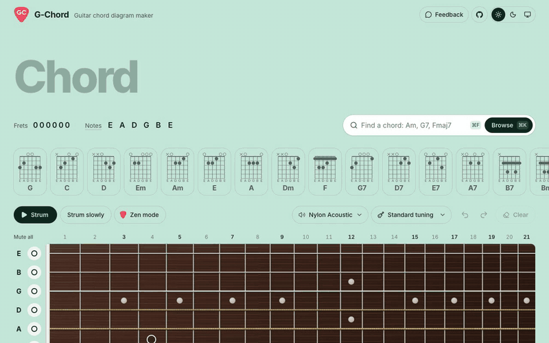
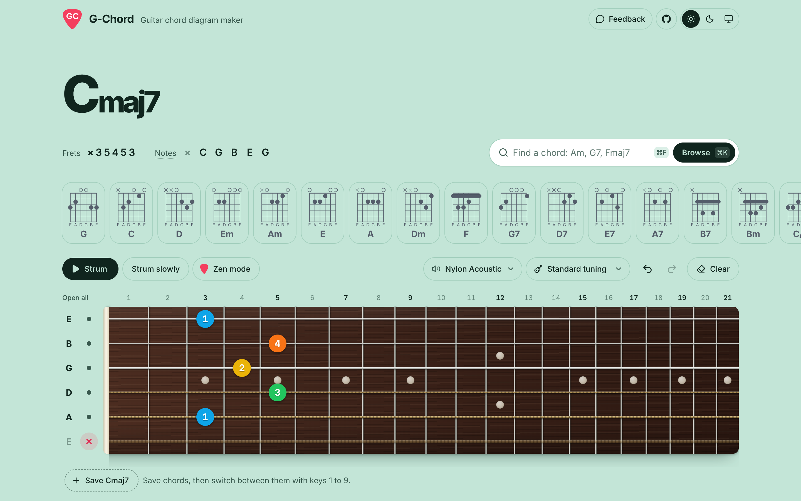
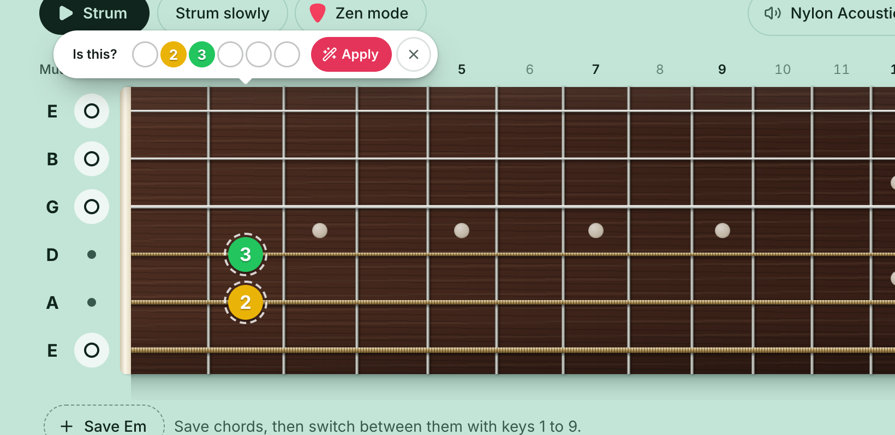
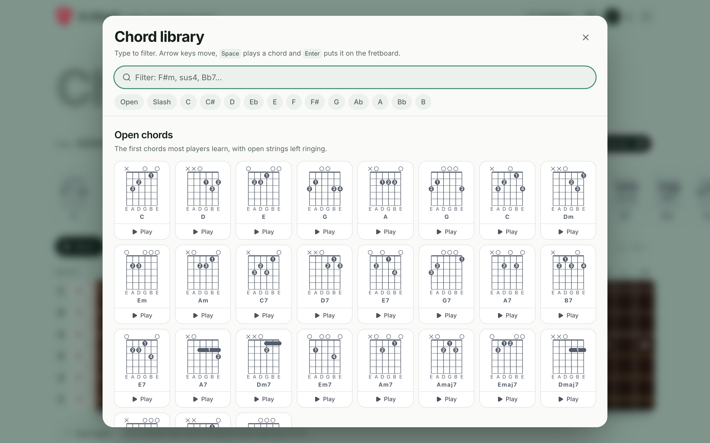
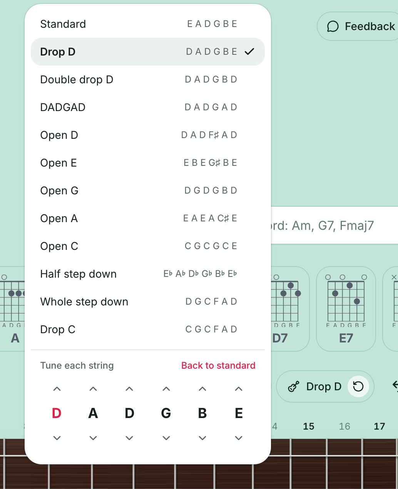
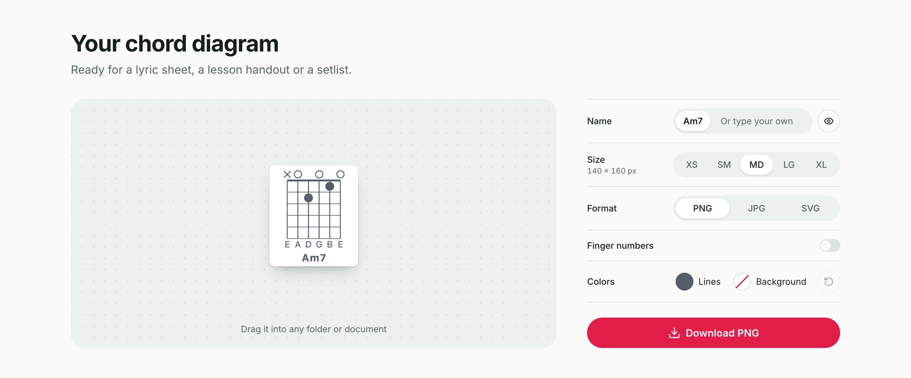
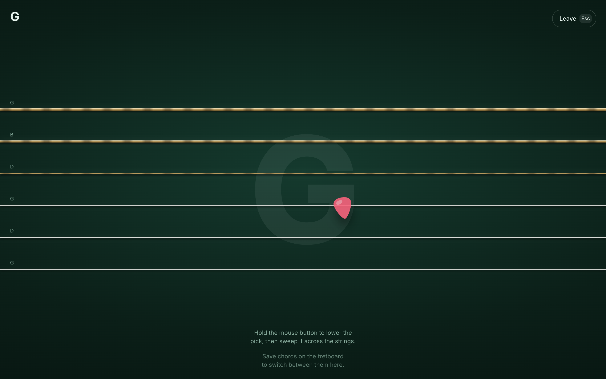
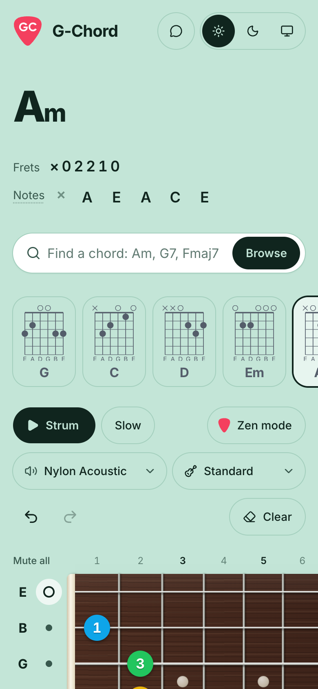
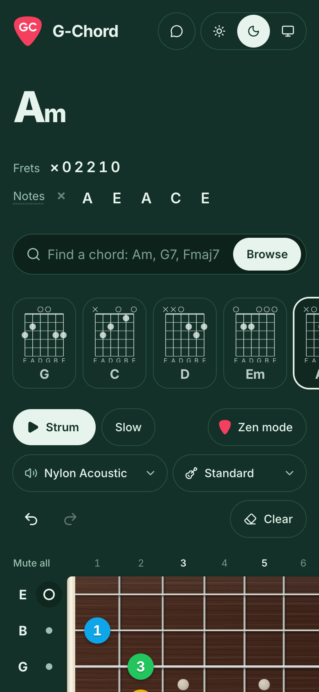

<div align="center">


# G-Chord

**Build any guitar chord on a real-looking fretboard, hear it, and drop a clean diagram straight into your lyric sheet.**

[**Open G-Chord →**](https://g-chord.vercel.app)

[](https://g-chord.vercel.app)
[](https://nextjs.org)
[](https://react.dev)
[](https://tailwindcss.com)
[](#license)

<br />



<sub>In the app, every chord you pick also plays. Prefer a video? <a href=".github/assets/demo.mp4">Watch demo.mp4</a></sub>

</div>

<br />

<picture>
  <source media="(prefers-color-scheme: dark)" srcset=".github/assets/hero-dark.png" />
  
</picture>

## Why

As a guitarist, I wanted a quick way to make those little chord boxes for the cheat sheets in my lyric documents. Drawing them by hand was slow, and most generators looked dated or couldn't do the chord I needed. So I built one that's pleasant to play with, and gives you a crisp image at the end.

## What you can do

### Build a chord and hear it

Click a fret to place a finger. Click it again to choose which finger (1 index, 2 middle, 3 ring, 4 pinky), and right-click or Shift-click to go back. Click the circles beside the strings to mute or open them.

G-Chord names the chord as you go, slash chords included, and shows the frets and the notes that sound. Strum it, strum it slowly, or click a single note to hear that string. Click **Notes** to hear the open strings in your tuning.

### Get the usual fingering

Placed the right frets with the wrong fingers? A small tooltip asks **"Is this?"** and shows the usual fingering. Point at it to preview the fingers on the fretboard, then click **Apply**, or close it.

<picture>
  <source media="(prefers-color-scheme: dark)" srcset=".github/assets/suggestion-dark.png" />
  
</picture>

### Find any of 273 chords

Search by name with <kbd>⌘</kbd> <kbd>F</kbd> (Am, G7, F#m7b5…), or open the library with <kbd>⌘</kbd> <kbd>K</kbd>. It has open chords, slash chords and movable shapes in all twelve keys. Filter as you type, move with the arrow keys, press <kbd>Space</kbd> to hear a chord and <kbd>Enter</kbd> to put it on the fretboard. The most common chords also sit one tap away in a row under the title.

<picture>
  <source media="(prefers-color-scheme: dark)" srcset=".github/assets/browse-dark.png" />
  
</picture>

### Play in other tunings

Pick from 12 presets, or retune each string up and down. Chord names and notes follow the tuning, and **Back to standard** is always one click away.

<table>
  <tr>
    <td width="50%" valign="top">
      <picture>
        <source media="(prefers-color-scheme: dark)" srcset=".github/assets/tuning-dark.png" />
        
      </picture>
    </td>
    <td width="50%" valign="top">

**Tunings**<br />
Standard · Drop D · Double drop D · DADGAD · Open D · Open E · Open G · Open A · Open C · Half step down · Whole step down · Drop C

**Sounds**<br />
Nylon acoustic · Steel acoustic · Jazz electric · Clean electric · Muted electric · Overdriven · Distortion · Harmonics

Real recorded guitar samples, played through the Web Audio API.

</td>
  </tr>
</table>

### Export a diagram you'd actually use

Every chord becomes a clean diagram, ready for a lyric sheet, a lesson handout or a setlist. Choose the size (XS to XL), the format (PNG, JPG or SVG), the line and background colours (transparent by default), and whether to show finger numbers and the name.

Then download it, or drag it straight into any folder or document. On a phone, press and hold to save or share.

<picture>
  <source media="(prefers-color-scheme: dark)" srcset=".github/assets/export-dark.png" />
  
</picture>

### Strum in Zen mode

A quiet, full-screen room with six strings and a pick. Hold the mouse button, or your finger on a phone, and sweep across the strings to strum. Switch chords with keys <kbd>1</kbd>–<kbd>9</kbd> as you play.



### Keep the chords of a song

Save the chords you need and switch between them with <kbd>1</kbd>–<kbd>9</kbd>. They stay in your browser between visits. Clearing them takes a deliberate press and hold, and you can still undo it.

### On your phone too

The whole app works by touch, with comfortable tap targets and a fretboard that scrolls edge to edge.

<p align="center">
  
  &nbsp;
  
</p>

## Keyboard shortcuts

| Keys | Action |
| --- | --- |
| <kbd>Space</kbd> | Strum the chord |
| <kbd>1</kbd>–<kbd>9</kbd> | Load a saved chord (works in Zen mode too) |
| <kbd>⌘</kbd> <kbd>F</kbd> or <kbd>/</kbd> | Find a chord |
| <kbd>⌘</kbd> <kbd>K</kbd> | Open the chord library |
| <kbd>⌘</kbd> <kbd>Z</kbd> | Undo |
| <kbd>⌘</kbd> <kbd>⇧</kbd> <kbd>Z</kbd> | Redo |
| <kbd>Esc</kbd> | Leave Zen mode or close a dialog |

On Windows and Linux, use <kbd>Ctrl</kbd> instead of <kbd>⌘</kbd>.

## Built with

- [Next.js 16](https://nextjs.org) and [React 19](https://react.dev), with the React Compiler
- [Tailwind CSS 4](https://tailwindcss.com) and [Base UI](https://base-ui.com) components in the [shadcn/ui](https://ui.shadcn.com) style
- [Lucide](https://lucide.dev) icons and the [Inter](https://rsms.me/inter/) typeface
- The Web Audio API, with samples from [MIDI.js soundfonts](https://github.com/gleitz/midi-js-soundfonts)
- [Biome](https://biomejs.dev) for linting and formatting

The fretboard, its wood, strings and inlays are drawn entirely in CSS.

## Run it locally

You'll need [Bun](https://bun.sh) (or Node.js 20+ with npm).

```bash
git clone https://github.com/aPinix/chord-generator.git
cd chord-generator
bun install
bun dev
```

Then open [localhost:3000](http://localhost:3000).

| Command | What it does |
| --- | --- |
| `bun dev` | Start the development server |
| `bun run build` | Build for production |
| `bun start` | Serve the production build |
| `bun run lint` | Check the code with Biome |
| `bun run format` | Format the code with Biome |

## Feedback

Found a bug or missing a chord? [Open an issue](https://github.com/aPinix/chord-generator/issues/new/choose), or use **Feedback** in the app to send an email with your device and browser already filled in.

## License

MIT

<br />

<p align="center">
  Made with ❤️ in Portugal by <a href="https://apinix.com">André Pinto</a> (<a href="https://github.com/aPinix">@aPinix</a>)
</p>
